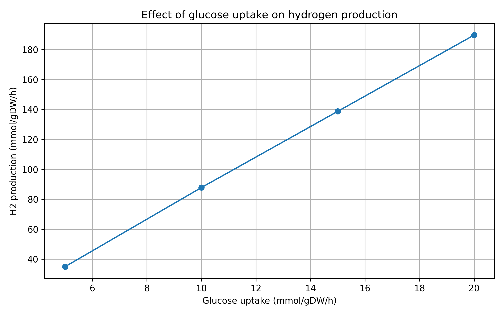

# E. coli Biohydrogen Production: Metabolic Model Reconstruction and Analysis

## Overview

This project focuses on the computational analysis of hydrogen production in *Escherichia coli* using the genome-scale metabolic model iML1515.

The study investigates metabolic pathways involved in biohydrogen production and evaluates how selected environmental and metabolic constraints influence hydrogen yield.

## Research Objectives

- Analyze the genome-scale metabolic model of *E. coli*.
- Investigate the role of formate hydrogen lyase (FHL) in hydrogen production.
- Evaluate the influence of anaerobic conditions on metabolic fluxes.
- Analyze the relationship between glucose uptake, growth rate and hydrogen production.
- Assess the effects of selected metabolic pathway constraints on hydrogen yield.

## Methods

- Genome-scale metabolic modeling
- Flux Balance Analysis (FBA)
- Anaerobic growth simulations
- Metabolic flux analysis
- Computational evaluation of hydrogen production

## Tools and Technologies

- Python
- COBRApy
- Google Colab
- pandas
- NumPy
- Matplotlib
- SciPy

## Repository Structure

```text
E-coli-biohydrogen-model/
│
├── data/
│   └── iML1515.xml.gz
│
├── notebooks/
│   └── E_coli_biohydrogen_analysis.ipynb
│
├── results/
│   └── README.md
│
├── scripts/
│   └── README.md
│
├── requirements.txt
└── README.md
```

## Model

The analysis is based on the iML1515 genome-scale metabolic model of *Escherichia coli*.

## Reproducibility

The computational analysis is performed in Python using COBRApy. Required Python packages are listed in `requirements.txt`.
## Results

The computational analysis demonstrated an increase in predicted hydrogen production with increasing glucose uptake under the applied model constraints.



The graph illustrates the relationship between glucose uptake and predicted hydrogen production based on Flux Balance Analysis (FBA).
## Important Note

All results are computational predictions obtained through metabolic modeling and Flux Balance Analysis (FBA). They do not represent experimentally validated measurements. The study is based on an existing metabolic model and does not claim experimental validation or de novo reconstruction of the iML1515 model.

## Author

Yuliia Marynych Khrystyna Malysheva
Stepan Gzhytskyi National University of Veterinary Medicine and Biotechnologies Lviv
